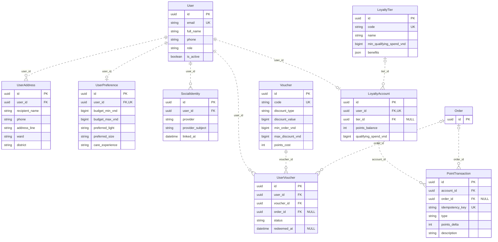
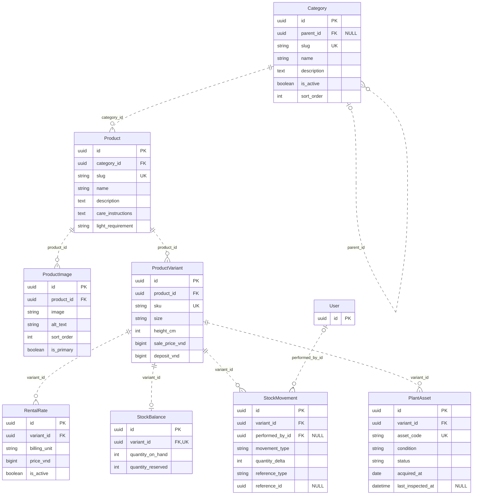
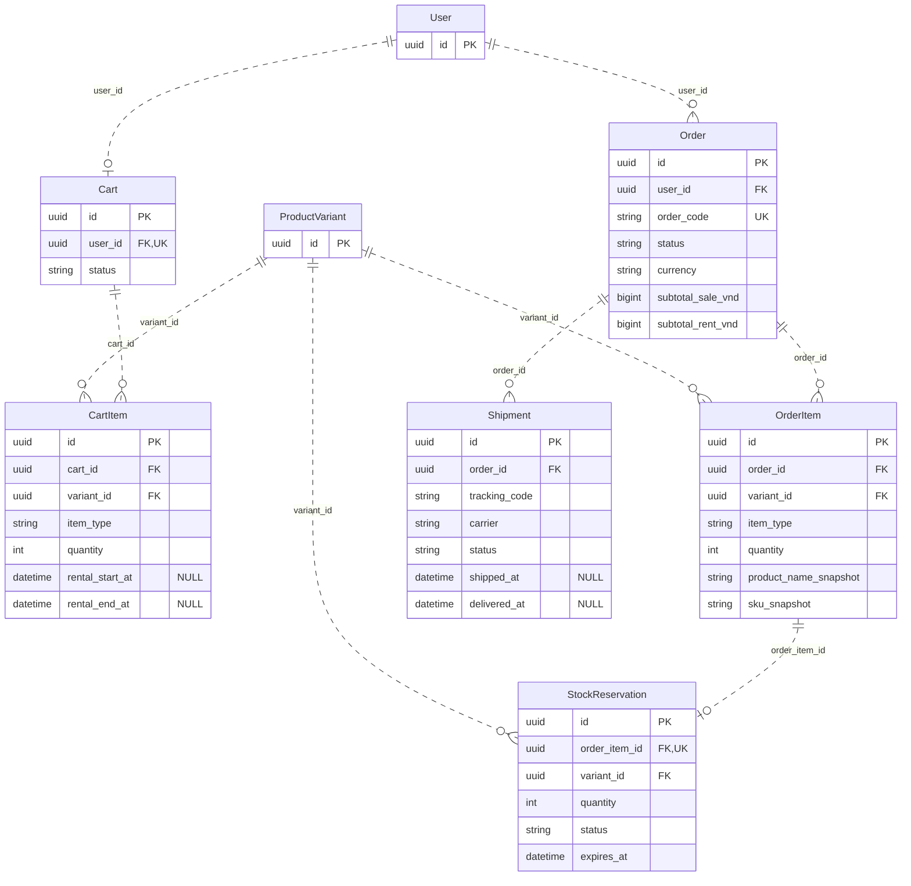
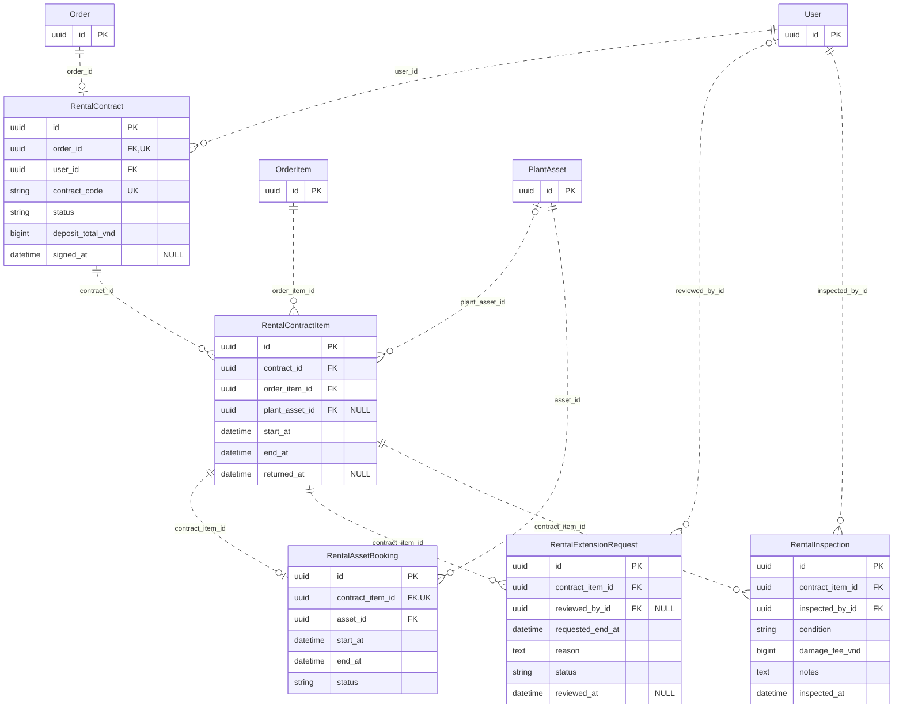
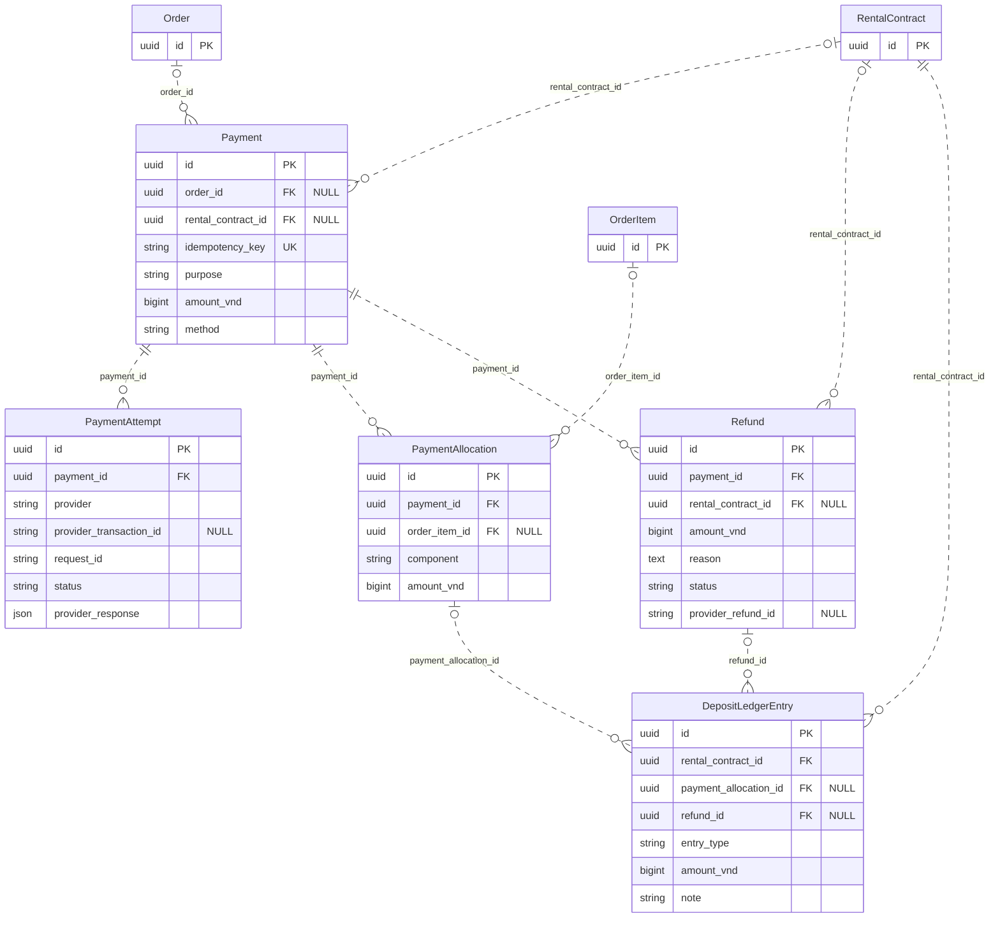

# Sơ đồ thực thể–quan hệ Plantify

Ngày đối chiếu mã nguồn: 24/10/2026.

ERD được trích từ 45 model nghiệp vụ của Django, gồm 64 quan hệ khóa ngoại / một-một. Đây là thiết kế theo mã nguồn; file SQLite local tại thời điểm kiểm tra vẫn trống. Không bao gồm bảng nội bộ Django (auth, admin, session, contenttypes) và các bảng many-to-many quyền hạn do PermissionsMixin sinh tự động.

## Cách đọc

- `PK`: khóa chính; `FK`: khóa ngoại; `UK`: khóa duy nhất trên một cột.
- `||`: đúng một; `o|` / `|o`: không hoặc một; `o{`: không hoặc nhiều.
- Một ForeignKey bắt buộc được biểu diễn `Parent ||..o{ Child`; ForeignKey nullable dùng `Parent |o..o{ Child`.
- OneToOneField bắt buộc dùng `Parent ||..o| Child`: một bản ghi con cần đúng một cha, nhưng cha có thể chưa có con.
- Nét đứt biểu thị quan hệ không định danh: mỗi bảng nghiệp vụ có khóa chính UUID riêng; FK không tham gia khóa chính.
- Cardinality phản ánh ràng buộc model, không giả định cha bắt buộc phải có bản ghi con.
- Các sơ đồ phân hệ hiển thị PK/FK/UK và một số thuộc tính chính; các bảng ngoài phân hệ chỉ hiển thị `id` để làm điểm nối.
- Mỗi bảng nghiệp vụ đều có `id`, `created_at`, `updated_at`; hai cột thời gian được lược bớt trong sơ đồ phân hệ.
- Bản đầy đủ mọi cột nằm trong [database-erd.mmd](database-erd.mmd). Kiểu dữ liệu là kiểu logic theo Django, không phải DDL riêng của SQLite/PostgreSQL. Khóa ngoại trong sơ đồ dùng tên cột vật lý, ví dụ `user_id`.

## Danh mục thực thể

| Phân hệ | Model | Tên bảng |
|---|---|---|
| accounts | `User` | `accounts_users` |
| accounts | `UserAddress` | `accounts_addresses` |
| accounts | `UserPreference` | `accounts_preferences` |
| accounts | `SocialIdentity` | `accounts_social_identities` |
| catalog | `Category` | `catalog_categories` |
| catalog | `Product` | `catalog_products` |
| catalog | `ProductImage` | `catalog_product_images` |
| catalog | `ProductVariant` | `catalog_product_variants` |
| catalog | `RentalRate` | `catalog_rental_rates` |
| inventory | `StockBalance` | `inventory_stock_balances` |
| inventory | `StockMovement` | `inventory_stock_movements` |
| inventory | `PlantAsset` | `inventory_plant_assets` |
| orders | `Cart` | `orders_carts` |
| orders | `CartItem` | `orders_cart_items` |
| orders | `Order` | `orders_orders` |
| orders | `OrderItem` | `orders_order_items` |
| orders | `StockReservation` | `orders_stock_reservations` |
| orders | `Shipment` | `orders_shipments` |
| rentals | `RentalContract` | `rental_contracts` |
| rentals | `RentalContractItem` | `rental_contract_items` |
| rentals | `RentalAssetBooking` | `rental_asset_bookings` |
| rentals | `RentalExtensionRequest` | `rental_extension_requests` |
| rentals | `RentalInspection` | `rental_inspections` |
| payments | `Payment` | `payments_payments` |
| payments | `PaymentAttempt` | `payments_payment_attempts` |
| payments | `PaymentAllocation` | `payments_payment_allocations` |
| payments | `Refund` | `payments_refunds` |
| payments | `DepositLedgerEntry` | `payments_deposit_ledger` |
| loyalty | `LoyaltyTier` | `loyalty_tiers` |
| loyalty | `LoyaltyAccount` | `loyalty_accounts` |
| loyalty | `PointTransaction` | `loyalty_point_transactions` |
| loyalty | `Voucher` | `loyalty_vouchers` |
| loyalty | `UserVoucher` | `loyalty_user_vouchers` |
| reviews | `ProductReview` | `reviews_product_reviews` |
| chatbot | `ChatConversation` | `chatbot_conversations` |
| chatbot | `ChatMessage` | `chatbot_messages` |
| chatbot | `BotIntent` | `chatbot_intents` |
| chatbot | `BotResponse` | `chatbot_responses` |
| cms | `Post` | `cms_posts` |
| cms | `Banner` | `cms_banners` |
| recommendations | `UserActivityEvent` | `recommendations_activity_events` |
| recommendations | `RecommendationLog` | `recommendations_logs` |
| notifications | `Notification` | `notifications_notifications` |
| system_settings | `SystemSetting` | `system_settings` |
| system_settings | `AuditLog` | `system_audit_logs` |

## Tài khoản và khách hàng thân thiết

Nhóm 1 — 9 bảng: quản lý danh tính, hồ sơ và quyền lợi của khách hàng.

| Bảng | Dùng để làm gì? |
|---|---|
| `accounts_users` | Lưu tài khoản đăng nhập, thông tin cá nhân và vai trò khách hàng/nhân viên/admin. |
| `accounts_addresses` | Lưu nhiều địa chỉ nhận hàng của một người dùng, có đánh dấu địa chỉ mặc định. |
| `accounts_preferences` | Lưu ngân sách, kích thước, ánh sáng ưa thích và kinh nghiệm chăm cây để phục vụ cá nhân hóa. |
| `accounts_social_identities` | Liên kết tài khoản nội bộ với định danh Google/Facebook; mỗi người dùng có thể có nhiều liên kết. |
| `loyalty_tiers` | Định nghĩa hạng thành viên, ngưỡng chi tiêu để đạt hạng và các quyền lợi. |
| `loyalty_accounts` | Lưu hạng hiện tại, số điểm khả dụng và chi tiêu tích lũy của từng khách hàng. |
| `loyalty_point_transactions` | Lưu lịch sử tăng/giảm điểm để giải thích và đối chiếu số dư điểm. |
| `loyalty_vouchers` | Định nghĩa mã giảm giá, mức giảm, điều kiện đơn hàng, hạn dùng và chi phí đổi bằng điểm. |
| `loyalty_user_vouchers` | Ghi nhận voucher nào thuộc người dùng nào, trạng thái sử dụng và đơn hàng đã áp dụng. |

Phân biệt: `loyalty_vouchers` là định nghĩa ưu đãi; `loyalty_user_vouchers` là lần cấp/đổi và sử dụng ưu đãi của một khách hàng. `loyalty_accounts` giữ số dư hiện tại, còn `loyalty_point_transactions` giữ lịch sử biến động.

## Danh mục sản phẩm và kho

Nhóm 2 — 8 bảng: mô tả cây đang kinh doanh và quản lý nguồn hàng để bán/cho thuê.

| Bảng | Dùng để làm gì? |
|---|---|
| `catalog_categories` | Phân loại sản phẩm; hỗ trợ danh mục cha/con. |
| `catalog_products` | Lưu tên cây, mô tả, hướng dẫn chăm sóc, yêu cầu ánh sáng và mức độ chăm sóc. |
| `catalog_product_images` | Lưu đường dẫn ảnh và thông tin ảnh của sản phẩm, ảnh chính và thứ tự hiển thị. |
| `catalog_product_variants` | Lưu từng SKU/kích thước/chiều cao, giá bán, tiền cọc và quyền bán/cho thuê. |
| `catalog_rental_rates` | Lưu bảng giá thuê theo ngày/tuần/tháng cho từng biến thể. |
| `inventory_stock_balances` | Lưu số lượng tồn kho bán và số lượng đang giữ chỗ theo biến thể. |
| `inventory_stock_movements` | Ghi nhật ký tăng/giảm kho, loại biến động, chứng từ tham chiếu và người thực hiện. |
| `inventory_plant_assets` | Quản lý từng cây vật lý cho thuê bằng mã riêng, tình trạng và trạng thái khai thác. |

Ví dụ: một sản phẩm “Trầu bà” có biến thể “Trầu bà cỡ M”. Kho bán ghi nhận số lượng của biến thể; cây cho thuê được quản lý riêng từng cây bằng `asset_code`. Tồn khả dụng để bán được tính từ tồn kho trừ số lượng đang giữ chỗ.

## Giỏ hàng và đơn hàng

Nhóm 3 — 6 bảng: lưu lựa chọn trước khi đặt hàng, giao dịch đặt hàng và giao nhận.

| Bảng | Dùng để làm gì? |
|---|---|
| `orders_carts` | Lưu giỏ hàng của một người dùng và trạng thái giỏ. |
| `orders_cart_items` | Lưu từng dòng mua/thuê trong giỏ: biến thể, số lượng và thời gian thuê dự kiến. |
| `orders_orders` | Lưu thông tin chung của đơn: khách đặt, mã đơn, trạng thái, các tổng tiền và địa chỉ nhận hàng tại thời điểm đặt. |
| `orders_order_items` | Lưu từng dòng mua/thuê đã đặt; chụp lại tên sản phẩm, SKU, giá, tiền cọc và thời gian thuê. |
| `orders_stock_reservations` | Giữ số lượng kho bán cho một dòng đơn hàng, kèm thời hạn và trạng thái giữ/xuất/giải phóng. |
| `orders_shipments` | Lưu lần giao hàng của đơn, đơn vị vận chuyển, mã theo dõi và trạng thái giao. |

Phân biệt: giỏ hàng có thể thay đổi trước khi đặt; đơn hàng lưu thông tin giao dịch đã tạo. `orders_stock_reservations` giải thích phần số lượng đang giữ trong `inventory_stock_balances` đang phục vụ dòng đơn nào.

## Hợp đồng và vận hành thuê cây

Nhóm 4 — 5 bảng: theo dõi từng cây thuê từ khi lập hợp đồng đến thu hồi và kiểm định.

| Bảng | Dùng để làm gì? |
|---|---|
| `rental_contracts` | Lưu hợp đồng thuê gắn với đơn hàng, khách thuê, mã hợp đồng, trạng thái và tổng tiền cọc. |
| `rental_contract_items` | Lưu từng cây trong hợp đồng: dòng đơn gốc, cây vật lý được gán, kỳ thuê, phí thuê, tiền cọc và tình trạng hoàn trả. |
| `rental_asset_bookings` | Lưu lịch sử dụng của một cây vật lý trong một khoảng thời gian; phục vụ kiểm tra trùng lịch khi phân bổ. |
| `rental_extension_requests` | Lưu yêu cầu gia hạn từng cây, ngày kết thúc mới, phí bổ sung và kết quả duyệt. |
| `rental_inspections` | Lưu lần kiểm định cây, người kiểm định, tình trạng, ghi chú và phí hư hỏng. |

Ví dụ: một dòng đơn thuê 3 cây được tách thành 3 `rental_contract_items`, để gán và theo dõi riêng từng cây. Hợp đồng lưu thỏa thuận thuê; booking lưu khoảng thời gian một cây cụ thể đã được bố trí.

## Thanh toán, hoàn tiền và tiền cọc

Nhóm 5 — 5 bảng: theo dõi khoản phải thu, kết quả giao dịch, phân bổ tiền và quyết toán cọc.

| Bảng | Dùng để làm gì? |
|---|---|
| `payments_payments` | Lưu khoản thanh toán cho đơn/hợp đồng: mục đích, số tiền, phương thức, trạng thái và khóa chống tạo lặp. |
| `payments_payment_attempts` | Lưu từng lần xử lý/thử thanh toán với nhà cung cấp, mã giao dịch và phản hồi nhận được. |
| `payments_payment_allocations` | Tách khoản thanh toán thành tiền mua, phí thuê, tiền cọc, vận chuyển, gia hạn hoặc phí hư hỏng. |
| `payments_refunds` | Lưu yêu cầu/kết quả hoàn tiền của một khoản thanh toán, số tiền, lý do và mã hoàn từ nhà cung cấp. |
| `payments_deposit_ledger` | Lưu từng biến động giữ cọc, hoàn cọc hoặc khấu trừ cọc theo hợp đồng. |

Ví dụ: khách trả 830.000 đồng gồm 500.000 đồng tiền thuê, 300.000 đồng cọc và 30.000 đồng vận chuyển. `payments_payments` ghi tổng khoản thanh toán; `payments_payment_allocations` ghi ba thành phần. Khi trả cây, tiền hoàn được ghi ở `payments_refunds` và biến động cọc ở `payments_deposit_ledger`. Số cọc còn giữ = tổng giữ cọc − tổng hoàn cọc − tổng khấu trừ.

## Đánh giá, chatbot, nội dung và hệ thống

Nhóm 6 — 12 bảng hỗ trợ: chăm sóc khách hàng, nội dung, gợi ý và vận hành hệ thống.

| Bảng | Dùng để làm gì? |
|---|---|
| `reviews_product_reviews` | Lưu điểm sao, bình luận và trạng thái duyệt đánh giá, gắn với người dùng, sản phẩm và dòng đơn hàng. |
| `chatbot_conversations` | Lưu phiên hội thoại, khách hàng, trạng thái bot/đợi nhân viên/nhân viên/đóng và người phụ trách. |
| `chatbot_messages` | Lưu từng tin nhắn của khách, bot hoặc nhân viên trong một hội thoại. |
| `chatbot_intents` | Định nghĩa chủ đề/ý định bot nhận diện, danh sách từ khóa và độ ưu tiên. |
| `chatbot_responses` | Lưu câu trả lời mẫu tương ứng với một ý định. |
| `cms_posts` | Lưu bài viết, tác giả, nội dung, loại bài và trạng thái/thời điểm xuất bản. |
| `cms_banners` | Lưu ảnh banner, liên kết đích, vị trí, thứ tự và thời gian hiển thị. |
| `recommendations_activity_events` | Ghi hành vi như xem/tìm kiếm/thêm giỏ/mua/thuê, phục vụ gợi ý; hỗ trợ cả khách vãng lai. |
| `recommendations_logs` | Ghi lần hệ thống tạo gợi ý, chiến lược, danh sách sản phẩm và ngữ cảnh gợi ý. |
| `notifications_notifications` | Lưu thông báo gửi tới người dùng, dữ liệu đính kèm và trạng thái đã đọc. |
| `system_settings` | Lưu tham số cấu hình theo khóa–giá trị JSON và người cập nhật. |
| `system_audit_logs` | Ghi ai thực hiện hành động gì, trên đối tượng nào, vào lúc nào và metadata liên quan. |

Phân biệt: activity events ghi hành động của người dùng; recommendation logs ghi kết quả gợi ý của hệ thống. Notifications hướng tới người nhận thông báo; audit logs phục vụ truy vết thao tác. Các bảng mô tả thiết kế dữ liệu, không đồng nghĩa mọi tính năng đã được tích hợp hoàn chỉnh.

```mermaid
erDiagram
    direction TB
    ProductReview["ProductReview"] {
        uuid id PK
        uuid user_id FK
        uuid product_id FK
        uuid order_item_id FK
        int rating
        text comment
        string status
    }
    ChatConversation["ChatConversation"] {
        uuid id PK
        uuid user_id FK "NULL"
        uuid assigned_agent_id FK "NULL"
        string status
        datetime closed_at "NULL"
    }
    ChatMessage["ChatMessage"] {
        uuid id PK
        uuid conversation_id FK
        uuid sender_user_id FK "NULL"
        string sender_type
        text content
        datetime sent_at
    }
    BotIntent["BotIntent"] {
        uuid id PK
        string name UK
        json keywords
        boolean is_active
        int priority
    }
    BotResponse["BotResponse"] {
        uuid id PK
        uuid intent_id FK
        text response_text
        boolean is_active
    }
    Post["Post"] {
        uuid id PK
        uuid author_id FK
        string slug UK
        string title
        text body
        string type
        string status
    }
    Banner["Banner"] {
        uuid id PK
        string title
        string image
        string link_url
        string position
        int sort_order
        datetime starts_at "NULL"
    }
    UserActivityEvent["UserActivityEvent"] {
        uuid id PK
        uuid user_id FK "NULL"
        uuid product_id FK "NULL"
        uuid anonymous_session_id "NULL"
        string event_type
        string search_query
        datetime occurred_at
    }
    RecommendationLog["RecommendationLog"] {
        uuid id PK
        uuid user_id FK "NULL"
        string strategy
        json product_ids
        json context
        datetime generated_at
    }
    Notification["Notification"] {
        uuid id PK
        uuid user_id FK
        string type
        string title
        text body
        json payload
        boolean is_read
    }
    SystemSetting["SystemSetting"] {
        uuid id PK
        string key UK
        uuid updated_by_id FK "NULL"
        json value
        string description
    }
    AuditLog["AuditLog"] {
        uuid id PK
        uuid actor_id FK "NULL"
        string action
        string entity_type
        uuid entity_id
        json metadata
        datetime occurred_at
    }
    OrderItem["OrderItem"] {
        uuid id PK
    }
    Product["Product"] {
        uuid id PK
    }
    User["User"] {
        uuid id PK
    }
    User ||..o{ ProductReview : "user_id"
    Product ||..o{ ProductReview : "product_id"
    OrderItem ||..o{ ProductReview : "order_item_id"
    User |o..o{ ChatConversation : "user_id"
    User |o..o{ ChatConversation : "assigned_agent_id"
    ChatConversation ||..o{ ChatMessage : "conversation_id"
    User |o..o{ ChatMessage : "sender_user_id"
    BotIntent ||..o{ BotResponse : "intent_id"
    User ||..o{ Post : "author_id"
    User |o..o{ UserActivityEvent : "user_id"
    Product |o..o{ UserActivityEvent : "product_id"
    User |o..o{ RecommendationLog : "user_id"
    User ||..o{ Notification : "user_id"
    User |o..o{ SystemSetting : "updated_by_id"
    User |o..o{ AuditLog : "actor_id"
```

## Khóa duy nhất kết hợp

- `accounts_social_identities`: UNIQUE (`provider`, `provider_subject`).
- `catalog_rental_rates`: UNIQUE (`variant_id`, `billing_unit`).
- `reviews_product_reviews`: UNIQUE (`user_id`, `order_item_id`).
